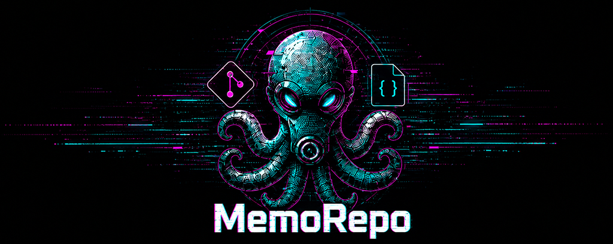
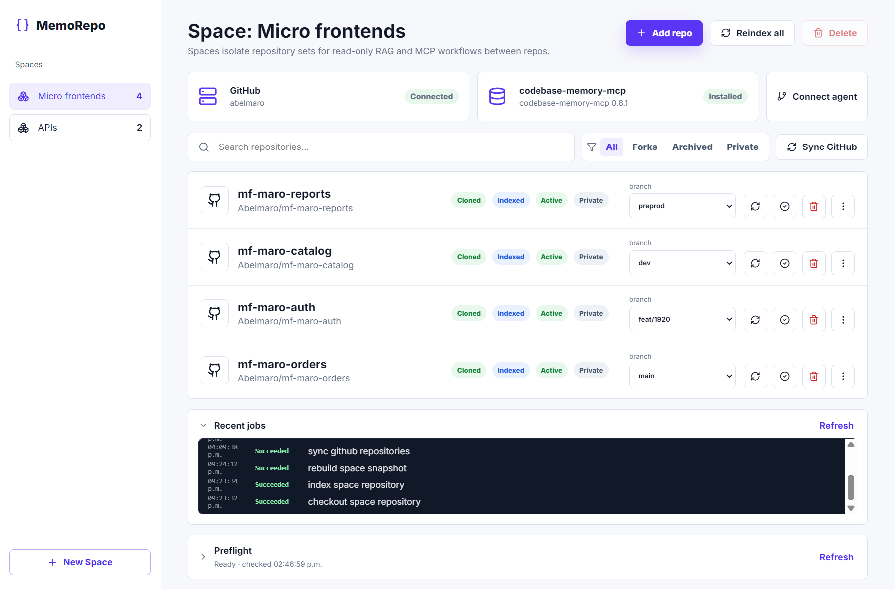

# MemoRepo

[](https://github.com/abelmaro/MemoRepo/actions/workflows/ci.yml)
[](https://github.com/abelmaro/MemoRepo/releases)
[](LICENSE)



**Local-first, read-only code intelligence for coding agents.**

MemoRepo turns related GitHub repositories into reproducible context for coding agents. It groups repositories into isolated spaces, captures exact commits as immutable snapshots, indexes their shared code graph with `codebase-memory-mcp`, and exposes verified source through a read-only [Model Context Protocol (MCP)](https://modelcontextprotocol.io/) server. It is designed for one developer on one workstation who needs cross-repository context without giving agents arbitrary filesystem or write access.



## Why MemoRepo

- **Cross-repository context:** query several related repositories through one space and one shared code graph.
- **Reproducible evidence:** every connection and chat is pinned to an immutable snapshot of exact commits.
- **Source-backed answers:** graph search is complemented by direct, exhaustive search over the captured source tree.
- **Narrow access:** agents receive space-scoped, read-only tools instead of general filesystem access.
- **Local control:** clones, indexes, operational state, and credentials remain in your local environment.

## Quick start

### Requirements

- Docker Desktop on Windows or macOS, or Docker Engine/Desktop on Linux.
- A GitHub account with access to the repositories you want to index.

Clone the project and start MemoRepo:

```bash
git clone https://github.com/abelmaro/MemoRepo.git
cd MemoRepo
docker compose up --build
```

On first start, the API generates a local control token and prints an unlock link:

```text
Unlock the MemoRepo dashboard: http://127.0.0.1:5173/#token=...
```

Open that link, then:

1. Create a space.
2. Sign in with GitHub when prompted, or configure `GH_TOKEN` in `.env`.
3. Add one or more repositories and wait for the immutable snapshot to become active.
4. Create a read-only connection and copy the generated MCP configuration into your coding agent.

The link is printed only when the token is created. To unlock another tab later, paste the token shown by `docker compose exec api cat /var/lib/memorepo-secrets/control-token`. A `.env` file is optional; copy `.env.example` only to override defaults. For storage options, agent connection modes, and troubleshooting, follow the [complete quickstart](docs/quickstart.md).

## How it works

1. A **space** groups repositories that belong to the same coding context.
2. MemoRepo checks out selected commits and materializes their source in an immutable, content-addressed store.
3. The snapshot index combines cross-repository graph discovery with direct source verification.
4. A space-scoped MCP gateway exposes only bounded, read-only query tools.
5. Optional in-dashboard chats use the same snapshot and require explicit consent before sending relevant context to the selected inference provider.

MemoRepo never edits, commits, or pushes to managed repositories. It is not designed as a public, network-exposed, or multi-user service.

## Security model

- The API and dashboard bind to `127.0.0.1` by default.
- The control plane and each MCP connection use separate bearer credentials.
- Repository credentials are not included in generated MCP configurations or model prompt payloads.
- Snapshot tools reject arbitrary filesystem paths and sanitize internal paths from responses.
- The dashboard explains which chat data is sent to a provider before you can consent.

Treat control tokens and generated MCP configurations as secrets. Do not expose MemoRepo through a reverse proxy or bind its ports to a public interface. See the [operating contract](docs/operating-contract.md) for the complete trust and data model.

## Documentation

| Guide | Covers |
| --- | --- |
| [Quickstart](docs/quickstart.md) | Installation, GitHub connection, spaces, agents, and troubleshooting |
| [MCP tools](docs/mcp-tools.md) | Connection modes, tool contracts, limits, and recommended agent workflow |
| [Operating contract](docs/operating-contract.md) | Runtime support, configuration, data ownership, boundaries, and security |
| [Changelog](CHANGELOG.md) | Releases and notable changes |

## Contributing

Contributions are welcome. Read the [contribution guide](CONTRIBUTING.md) for development setup and validation commands, and follow the [Code of Conduct](CODE_OF_CONDUCT.md).

Use [GitHub Issues](https://github.com/abelmaro/MemoRepo/issues) for bugs and feature requests. Report vulnerabilities privately according to the [security policy](.github/SECURITY.md).

## License

MemoRepo is available under the [MIT License](LICENSE).
